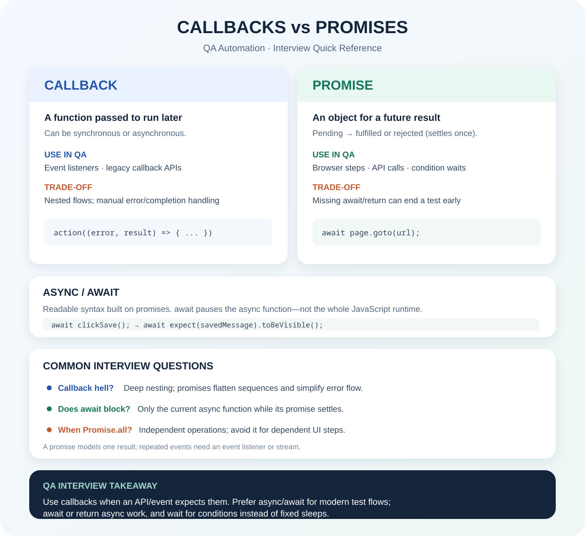

# Learning JavaScript

A hands-on collection of JavaScript examples, coding exercises, and study notes. The repository follows a chapter-based learning path—from language basics and control flow through arrays, functions, strings, and objects—with additional practice problems and QA interview references.

## What you'll find

- **Chapter examples** that demonstrate JavaScript syntax and core concepts in small, focused files.
- **Coding practice** covering string manipulation, patterns, arrays, and everyday problem-solving.
- **Study notes and references** for topics such as hoisting, the temporal dead zone, callbacks, promises, and async/await.
- **QA-focused exercises and materials** alongside general JavaScript practice.

## Repository structure

| Folder | Contents |
| --- | --- |
| `01_chapter_JS_Basics/` – `03_chapter_JS_Literals/` | JavaScript basics, keywords, identifiers, and literals |
| `04_chapter_JS_Operators/` – `05_chapter_JS_Incre_Decr_Op/` | Operators, expressions, and increment/decrement |
| `06_chatper_if_else_statement_Condition/` – `07_chapter_switch/` | Conditional logic and `switch` statements |
| `08_chapter_UserInput/` – `11_chapter_Loops_DoWhile/` | User input and loop examples |
| `12_chapters_Arrays/` | Array creation, access, iteration, transformation, sorting, and destructuring |
| `13_chapter_Functions/` – `15_chapter_Functions_Closure/` | Functions, arrow functions, hoisting, and closures |
| `16_chapter_String/` – `18_Multi_Dimensions_Array/` | Strings, objects, and multidimensional arrays |
| `00_chapter_Prompt_Eng/` | Prompt-writing and QA test-planning documents |
| `Tasks/` | Dated coding exercises, QA study notes, and supporting materials |

Chapter folders are numbered to make the intended progression easy to follow. Many files are standalone examples rather than parts of a single application.

## Getting started

### Prerequisites

- [Node.js](https://nodejs.org/)
- npm, which is included with Node.js

### Install the dependency

From the repository root, install the package dependencies:

```bash
npm install
```

The examples use Node.js CommonJS modules. A few input examples use the `prompt-sync` dependency; many others run directly with Node.js.

### Run an example

Run a file by passing its path to Node.js:

```bash
node 01_chapter_JS_Basics/01_HelloWorld.js
node 12_chapters_Arrays/78_Array.js
```

For a prompt-based example:

```bash
node 08_chapter_UserInput/61_Prompt_sync.js
```

Some examples read directly from standard input. For example, provide input with a pipe:

```bash
printf '15\n' | node 08_chapter_UserInput/62_FS_readFile.js
```

You can also run that example interactively: enter a value, then send EOF (`Ctrl+D` on macOS/Linux or `Ctrl+Z`, then Enter, on Windows).

## Practice topics

The dated `Tasks/` folder includes exercises and reference materials such as:

- String reversal, palindrome checking, duplicate-character removal, anagrams, and vowel/consonant counting
- Triangle and pyramid pattern printing
- Callbacks, promises, and async/await for QA automation
- QA planning documents and notes

### Callbacks and promises quick reference



Additional screenshots from the string exercises are available in [`Tasks/30Oct26/`](Tasks/30Oct26/).

## Tests

The repository is a collection of learning examples and does not currently have an automated test suite configured. Run individual JavaScript files with Node.js to try them.

## License

This project declares the [ISC license](https://opensource.org/license/isc/) in `package.json`.
